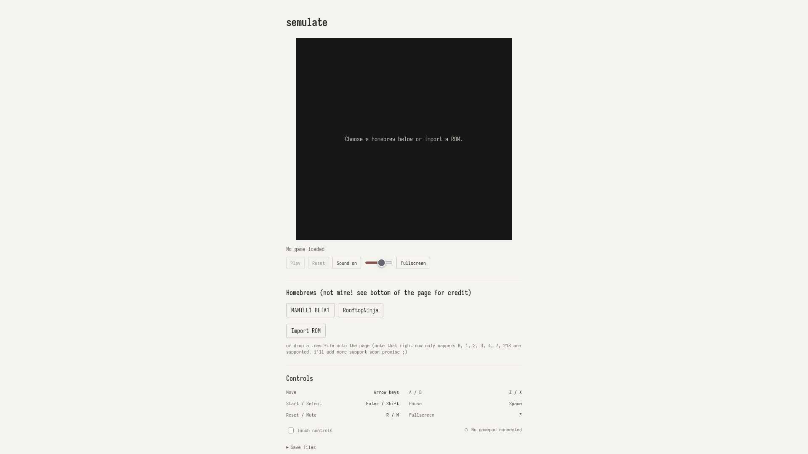

# Semulate

A NES emulator written in Rust. I made this for [Crescent](https://crescent.hackclub.com/), as part of [HackClub](https://hackclub.com/).

[Play the demo!](https://crtscreen.github.io/semulate/)



## Using the demo

You can choose a game from the **Homebrews** section, or import a local `.nes` file by clicking **Import ROM** or dragging the file onto the page.

*If you are importing a ROM, please see the [compatibility](#compatibility) section below.*

### Controls

| Key | Action |
| --- | --- |
| Arrow keys | Move |
| Z / X | A / B |
| Enter / Shift | Start / Select |
| Space or P | Pause / Resume |
| R | Reset |
| M | Mute |
| F | Fullscreen |

There's also a button for touch controls. It's useful for accessibility, and I kinda had to add them for testing because I have a 60% keyboard. Gamepads are also supported.

Games with battery-backed RAM can save progress in browser storage, and you can use the **Save files** section to import or export `.sav` files. Note: these are not save states, but cartridge saves.

## Compatibility

Right now this project only supports NTSEC NES cartridges with iNES or NES 2.0 headers using these mappers:

| Mapper | Cartridge type |
| --- | --- |
| 0 | NROM |
| 1 | MMC1 |
| 2 | UxROM |
| 3 | CNROM |
| 4 | MMC3 |
| 7 | AxROM |
| 218 | Magic Floor |

This isn't really a guarantee because I haven't tested every ROM file for every game available so YMMV. But based on my tests the above list of mappers should work.

## Build and run

You can clone this repo and build the project yourself. 

### Browser

Install Rust, Python 3.11 or later, and the WebAssembly target:

<details>
  <summary>Linux</summary>
  
  ```sh
  rustup target add wasm32-unknown-unknown
  python3 tools/build_web.py
  python3 -m http.server 8080 --directory dist
  ```
  Then go to your web browser of choice and open http://localhost:8080. You can edit the frontend files in `web/`, if you wish. Make sure to rebuild after doing so:

  ```sh
  python3 tools/build_web.py
  ```

</details>

<details>
  <summary>Windows</summary>

  ```sh
  rustup target add wasm32-unknown-unknown
  python tools/build_web.py
  python -m http.server 8080 --directory dist
  ```
  Then go to your web browser of choice and open http://localhost:8080. You can edit the frontend files in `web/`, if you wish. Make sure to rebuild after doing so:

  ```sh
  python tools/build_web.py
  ```

</details>

### Desktop

The desktop frontend requires SDL2. To run a ROM:

```sh
cargo run --release -- "roms/<YOUR_GAME_HERE>.nes"
```

## Testing

Some of these tests were written with AI assistance, specifically `web.test.mjs`, `test_build_web.py`, and `banking.rs`.

To run them:

```sh
cargo fmt --check
cargo test
cargo test --no-default-features
node --test tests/web.test.mjs
```

The Rust tests cover CPU instructions, memory mapping, controllers, PPU registers, cartridge banking and saves. The browser tests test the built WebAssembly, ROM loading, saves, input and audio. Please note that the game tests expect the `MANTLE1_BETA1.nes` and `RooftopNinja.nes` files in the `roms/` folder. Make sure to build the web distribution before running them.

## Credits

The games included in the demo were not created by me. I got them from itch.io:

- [RooftopNinja](https://drludos.itch.io/rooftop-ninja)
- [The Legend of Tenna (NES)](https://ske2004.itch.io/mantle)

These are really cool, please check out the creators! I've only included them in this project to show that my emulator works.

Hardware documentation: [NESdev Wiki](https://www.nesdev.org/wiki/Nesdev_Wiki).

Test resources: [NES test ROMs](https://github.com/christopherpow/nes-test-roms) and [nestest](https://www.qmtpro.com/~nes/misc/).
